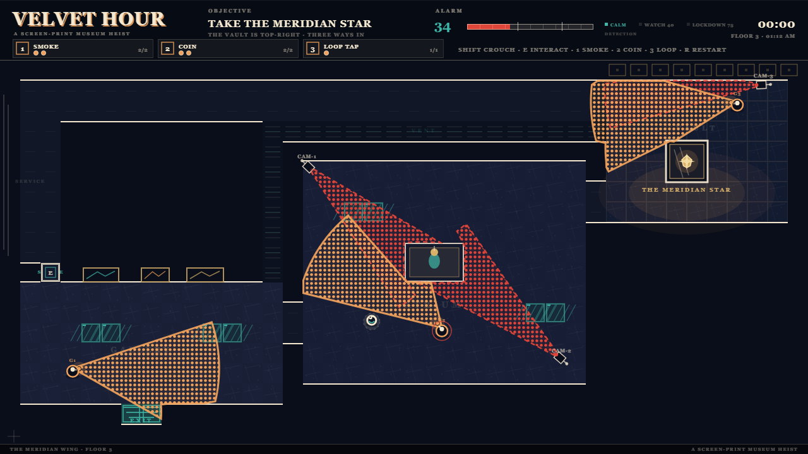

# VELVET HOUR

**A screen-print museum heist. One floor, three ways in, one way out.**

[](https://make.fun/bounty/best-heist-game-20261122-0559)
[](https://make.fun/bounty/best-heist-game-20261122-0559)
[](https://make.fun/bounty/best-heist-game-20261122-0559)



It is 01:12 AM on the third floor of the Meridian wing. The Meridian Star sits in a lit
vitrine in the vault, top-right. You came in through the gallery's fire escape, bottom-left,
and the same fire escape is the only way out. Between the two lies one museum floor, all of
it inside a single 1280x720 frame: no scrolling, no zoom, no hidden rooms. Three lanterns
walk their beats, three ceiling lenses sweep the floor, and the alarm meter never leaves the
top of the screen.

## The job

Take the Meridian Star from the vitrine, then get back to the fire escape. Hold **E** at the
case for 1.5 seconds. Hold **E** at the fire escape once you are carrying it. That is the
whole objective, and the museum has other plans.

## Controls

| Key | What it does |
| --- | --- |
| **WASD / arrows** | walk; the body slides along corners instead of sticking |
| **Shift** | crouch: 74 px/s, half detection gain, no footstep noise, hidden behind teal low cover |
| **E** (hold) | open the service door (1.2 s), take the jewel (1.5 s), leave through the fire escape (instant) |
| **1** | smoke: a 58 px disc for 4 s that cuts every sight line and every cone through it |
| **2** | coin: throw toward the mouse up to 210 px; the nearest guard within 340 px walks to it for 3 s |
| **3** | loop tap: freeze all three cameras for 5 s (their cones go teal and blind) |
| **mouse** | aims the coin |
| **R** | restart |
| **Space / Enter / click** | start |

## The belt

Five charges: two smokes, two coins, one loop tap. Each use adds **+6 alarm heat**, and the
crawlspace refuses all three (half speed and no tools). Tools are the only way to buy a beat
from a lantern you already walked into; the alarm remembers every purchase.

## The alarm

The meter runs 0 to 100 and never hides. A guard or a camera that sees you adds heat by
distance: 45/s under 92 px, 22/s under 176 px, 10/s beyond. Crouching halves it; a locked
camera multiplies by 1.55. With nothing seeing you, it bleeds 6/s after a 0.45 s grace.

- **CALM** (under 40): the museum as designed.
- **WATCH** (40+): every lantern cone grows 12% wider and patrols speed up 15%.
- **LOCKDOWN** (75+): the cameras sweep faster and a searchlight starts sweeping the gallery
  from your only exit at 20/s. A klaxon joins the low pulse.
- **100**: **BUSTED**, and the card names what filled the meter — GUARD 2, CAM-3, the exit
  searchlight. The house closes the doors.

A guard's hand only closes after 0.35 s of continuous contact, so being brushed never loses
the run without a beat to break away. After 0.9 s of sight a guard stops and stares with a
1.3x cone, walks to the spot where it last saw you, searches it for 3 s, then goes back to
its beat. A coin or a groaning service door pulls the nearest guard off that beat instead.

## Three ways in

1. **Main hall.** Gallery -> the arch at the right -> atrium -> the vault arch at (29,6) ->
   vault. The shortest line, and the one the two atrium lenses and GUARD 2 own. Read the
   sweeps, cross behind the plinth, use the teal cover.
2. **Service corridor.** The door in the gallery's left wall (hold E, 1.2 s) opens onto a
   corridor that runs up the left edge and across the top passage to the vault's west arch.
   It skips the atrium entirely, but the door groans and pulls the nearest guard to it.
3. **Vent crawl.** The gallery ceiling at (13,10) is a one-tile duct that runs up the wall
   between gallery and atrium, east above the atrium, and down into the vault at (29,3). It
   is half speed, crouched, out of every camera's line, and no tool can be used inside it.
   Slow but blind. You can crawl back with the jewel too.

## The look

Screen-print noir. Flat ink, hard edges and per-tile hatching; walls are ink with a cream line
on every face that meets a floor, which is what makes the plan legible at thumbnail size.
Every vision fan is a halftone dot screen in its pure palette colour behind a 3 px edge:
amber for lanterns, alarm red with a dashed edge for the lenses, cream for the lockdown
searchlight. Low cover is teal; danger is red; the loot is warm gold. The vitrine has a cream
frame, a gold inner line, an amber floor pool, a faceted jewel with a four-point sparkle and
its name underneath. No gradients, no external art, no fonts to download: every mark is drawn
by the game and every sound is synthesised in WebAudio. The grain is a seeded PRNG, so seed 7
always paints the same frame.

## Run it

The game is static files with no build step and no network requests. From the repository root:

```sh
node serve.ts --port 8099
```

Then open <http://localhost:8099>. Or serve the `game/` directory with any static server:

```sh
cd game
python -m http.server 8099
```

Open <http://localhost:8099> in desktop Chrome (or Edge). It also plays from a `file://` page
in Chrome with modules allowed, but a static server is the supported path.

## Files

```
game/index.html     the canvas, the page frame, the error catcher
game/styles.css     letterbox and cursor, nothing else in the DOM
game/js/main.js     boot, fixed 60 Hz loop, input, shot dispatch, window.__velvet
game/js/level.js    the floor plan, collision, raycasts, routes, camera mounts
game/js/player.js   movement, crouch, vent crawl, hold-to-act, carrying
game/js/guards.js   patrols, dwell, stare, search, lure, sight, contact
game/js/cameras.js  sweep, wall stop, lock-on, sight, loop freeze
game/js/alarm.js    meter, stages, gain and decay, lockdown searchlight, busted
game/js/tools.js    smoke, coin, loop tap: charges, effects, heat
game/js/render.js   the world: floor, walls, props, cones, actors
game/js/hud.js      meter, belt, objective, clock, title, win and lose cards
game/js/audio.js    WebAudio synth voices
game/js/shots.js    deterministic staging for the four screenshots
game/js/rng.js      seeded PRNG for all texture
```

Screenshots are real renders of this code, taken at 1280x720 with `?shot=<name>&seed=7`:
[cover](screenshots/1-cover.png), [smoke](screenshots/2-smoke.png),
[loot](screenshots/3-loot.png), [win](screenshots/4-win.png). `main.ts` copies `game/` and
`screenshots/` to the output directory and writes `dossier.json` with `vendor/makefun-game.ts`.

MIT. See [LICENSE](LICENSE).
